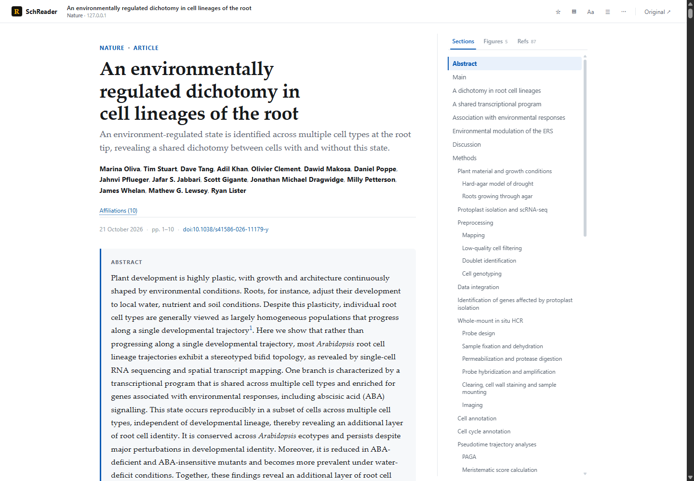

**English** · [中文](README.zh-CN.md)

# SchReader

Read any publisher's paper page in a clean, Nature-style layout. Chrome/Edge extension + Android app, one shared extractor.



## What you get

- **One text column** with a fixed **Sections / Figures / References** rail on the right
- **Citation previews** on hover, and a **figure lightbox** (zoom, pan, arrow-key navigation)
- **Highlights** in 6 colours and **selection translation**
- **My library**: save papers, tag them, add notes, resume where you stopped, export to BibTeX / RIS / CSV / JSON
- **17 themes and 7 fonts**; Inter and IBM Plex Sans ship with the extension, so they work offline
- **Sync** between browser and phone through a private gist of your own

## Privacy: what is and isn't stored

SchReader re-renders the tab you already have open, using your own login session. That means paywalls, Cloudflare and institutional access just work.

- **Not stored:** article text. Nothing is downloaded or saved.
- **Stored locally in your browser:** a library entry per saved paper (title, authors, journal, DOI, link, your tags and note, reading position), your highlights, and a short reading history.
- All of it stays on your machine and can be removed from the library page. The reading history has a one-click off switch.

## Install

**Easiest:** download the extension zip or the APK from the [latest release](https://github.com/XijlI/SchReader/releases/latest).

**From source (about 30 seconds):**

1. Open `chrome://extensions` (Edge: `edge://extensions`) and switch on **Developer mode**.
2. Click **Load unpacked** and select this repo's `extension` folder.
3. Pin the puzzle-piece icon to the toolbar.

Not a developer? Follow the click-by-click guide in [docs/INSTALL.md](docs/INSTALL.md). For the phone, see [android/README.md](android/README.md).

## Quick start

1. Click the toolbar icon. **My library** opens in its own tab.
2. Open a paper on a supported publisher; the pill appears once the body has loaded.
3. Click the dark **R SchReader** pill in the bottom-right corner.
4. The reader takes over the tab. Use **Original ↗** to go back to the publisher page.

Tip: Ctrl/Cmd-click or middle-click the pill to keep the original page open.
The **▾** next to the pill offers *convert this site automatically*, *hide the button here* and *allowed sites…*.

## Supported sites

SchReader runs only on publishers it knows about: ScienceDirect, Wiley, Springer, Cell, Science, PNAS, PLOS, Frontiers, MDPI, IEEE, ACM, JSTOR, bioRxiv, CNKI and about three dozen more. Every other site is left untouched. The full list is in [extension/src/whitelist.js](extension/src/whitelist.js).

**Adding a site:** in the reader, open **▾ → allowed sites…** (or My library → **⚙ → Allowed sites**). The domain is pre-filled; click **Allow site**, approve the Chrome permission prompt, and the pill will appear there from then on.

### Parser status

Seven publishers have been tested against real pages. The numbers are what the parser found.

| Publisher | Citation style | Tested on | Sections | Paragraphs | Figures | Refs |
| --- | --- | --- | --- | --- | --- | --- |
| ScienceDirect | Author–year | Saved page | 19 | 51 | 10 | 64 |
| Wiley Online Library | Author–year | Saved page | 13 | 44 | 3 | 68 |
| Cell | Numeric | Saved page | 20 | 55 | 3 | 79 |
| PNAS | Numeric | Saved page | 16 | 28 | 4 | 43 |
| PLOS | Numeric | Live page | 25 | 40 | 7 | 48 |
| Frontiers | Numeric | Live page | 28 | 64 | 4 | 51 |
| Nature | Numeric | Live page | 65 | 110 | 5 | 87 |

All other listed sites use a generic fallback (`citation_*` meta tags plus heuristics) and are best-effort. The `⋯` panel in the reader shows what was actually found.

## Using the reader

| Action | Result |
| --- | --- |
| Hover a superscript citation | Full reference card with a DOI link |
| Click a citation | Rail switches to References and pins it; the text doesn't scroll |
| Click `↑ cited 3×` on a reference | Jump back to where the text cites it |
| Click a figure, or **Expand** | Lightbox: wheel to zoom (25–600%), drag to pan, ← → to switch figures |
| Select text, click the pen | Highlight in the current colour (right-click the pen for 6 colours) |
| Select text, click 译 (or press `Y`) | Translate the selection in a floating card; **Copy** or **Save to note** (keeps both languages in the paper's library note) |
| `Aa` | Theme, typeface, custom colours, text size, line height, column width, alignment |
| `⋯` | Parse diagnostics: paragraphs, figures and references found |

**Keyboard shortcuts:** `J` / `K` next/previous section · `S` / `F` / `R` Sections / Figures / References · `T` theme · `Z` collapse rail · `Y` translate selection · `Esc` close

Highlights are stored per article in `chrome.storage.local`, keyed by DOI.

## My library

Open it from the toolbar icon, or from the **▤** button in the reader. Save a paper with **☆** in the reader's top bar.

- Search by title, author, DOI or tag; sort by added, last read, title or year
- Tags, a free-text note, and a saved reading position per paper ("Resume" appears next time)
- Reading history, with a one-click off switch
- **Export** as BibTeX, RIS, CSV or JSON (works with Zotero, EndNote, NoteExpress); **import** from BibTeX or a JSON backup
- A **wordbook** of words saved from the translation card (**★**): the word, its translation, the sentence it came from and the paper — **export it as TSV for Anki or CSV for a spreadsheet**
- **⚙ Settings**: theme, typeface and size, selection translation (on/off, target language), allowed sites, version
- **Sync across devices**: library, reading positions and highlights, via a private gist of your own. Setup is in [docs/INSTALL.md §6](docs/INSTALL.md)

A saved "paper" is just metadata plus the link. The article body is re-parsed from the publisher page each time you open it, which keeps the store tiny.

## Android app

The Android app in `android/` uses the same parsers and the same reader page. It opens on **My library**, with three tabs at the bottom:

- **Library**
- **Search**: a shelf of journal home pages (Google Scholar first, plus any you add)
- **Settings**

The bottom bar slides away as you scroll, and the whole app follows the reader's theme, including custom colours. The built-in browser supports up to 8 tabs, restored after a restart. Tapping *Search* again returns you to the page you opened from it before going back to the shelf.

## Limitations

- It reads only the text already on the page. A PDF-only or iframe-only article gives you the abstract and nothing more.
- A publisher redesign can break a selector. The `⋯` panel shows which counter dropped to 0.
- Images load from the publisher's CDN. A few sites refuse cross-site requests, and a text note is shown instead.

## Documentation

| Doc | What's in it |
| --- | --- |
| [docs/INSTALL.md](docs/INSTALL.md) | Click-by-click install and a reader tour, for non-programmers |
| [android/README.md](android/README.md) | The phone build: install, build, what gets mirrored |
| [docs/PLAN.md](docs/PLAN.md) | Architecture, the article model, the whitelist, verified layouts |
| [docs/RELEASING.md](docs/RELEASING.md) | How a release (signed APK + extension zip) is cut |

## Development

```
extension/            the folder you load into the browser
  src/whitelist.js    allowed-site list and matching rules
  src/content.js      page detection, the pill, triggers parsing
  src/background.js   holds the parse result in memory, opens the reader/library,
                      registers content scripts for sites you added
  src/extractor/      page to article model (meta, blocks, refs, figures, adapters)
  library.*           My library (list, tags, notes, export, history)
  search.*            the Search shelf (journal shortcuts + your own sites)
  settings.js         settings panel: extension modal + app page, one implementation
  library-store.js    the only store, shared by all three hosts
  options.html        forwards to library.html?settings=1 (Chrome's "Extension options")
android/              the Android app
dev/                  local harness: static server + POST /save
samples/              pages saved with Ctrl+S, used as parser fixtures (gitignored)
```

Run the local harness:

```
python3 dev/serve.py 8799
# then open http://127.0.0.1:8799/extension/reader.html?dev=article.json
```

Checks CI runs on every push and pull request (`.github/workflows/ci.yml`):

```
python3 .github/scripts/sync_whitelist.py --check   # manifest.json and whitelist.js in sync
python3 .github/scripts/check_consistency.py       # themes, extractor order, mirrored pages
node dev/sync-sim.mjs                              # the store's merge, on two simulated devices
```
