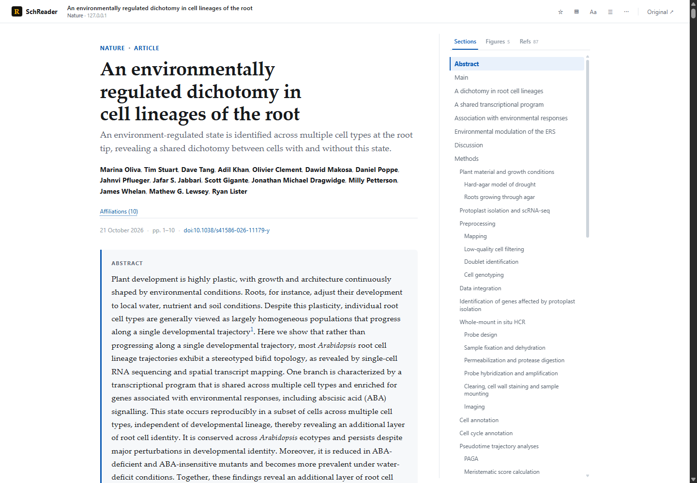

**中文** · [English](README.md)

# SchReader

把任何出版社的论文页面，读成干净、Nature 风格的排版。Chrome/Edge 扩展 + 安卓 App，共用一套抽取器。



## 你会得到什么

- **正文一栏**，右侧固定 **Sections / Figures / References** 栏
- **角标引用悬停预览**，以及**图片灯箱**（缩放、拖动、方向键切换）
- **6 种颜色的高亮**和**划词翻译**
- **我的文库**：收藏论文、打标签、写备注、从上次位置继续读，导出 BibTeX / RIS / CSV / JSON
- **17 套主题、7 种字体**；Inter 和 IBM Plex Sans 随扩展打包，离线可用
- **多设备同步**：浏览器和手机之间，走你自己的私有 gist

## 隐私：存了什么，没存什么

SchReader 只是把**你已经打开、已经登录**的那个标签页重新排版，用的是你自己的会话。所以付费墙、Cloudflare、机构登录都不成问题。

- **不保存**：正文。不下载、不落地。
- **存在浏览器本地**：每篇收藏论文的条目（题名、作者、期刊、DOI、链接、你自己打的标签和备注、阅读位置）、你的高亮，以及一份简短的阅读历史。
- 这些都在你自己的机器上，可以在文库页面删掉；阅读历史有一键关闭开关。

## 安装

**最省事：** 从[最新 Release](https://github.com/XijlI/SchReader/releases/latest) 下载扩展 zip 或 APK。

**从源码装（约 30 秒）：**

1. 打开 `chrome://extensions`（Edge 是 `edge://extensions`），开启**开发者模式**。
2. 点**加载已解压的扩展程序**，选中本仓库的 `extension` 文件夹。
3. 把拼图图标钉到工具栏。

不写代码？看逐步图文说明：[docs/INSTALL.zh-CN.md](docs/INSTALL.zh-CN.md)。手机版见 [android/README.zh-CN.md](android/README.zh-CN.md)。

## 快速开始

1. 点工具栏图标，**我的文库**在独立标签页里打开。
2. 在支持的出版社页面上打开一篇论文；正文加载完成后，胶囊按钮自己会出现。
3. 点右下角的深色胶囊：**R SchReader**。
4. 阅读页接管这个标签。点 **Original ↗** 回到出版社原页。

小技巧：按住 Ctrl/Cmd 点胶囊（或鼠标中键）可以保留原页面。
胶囊旁的 **▾** 里有：*这个站点自动转换*、*在这里隐藏按钮*、*允许的站点…*。

## 支持的站点

SchReader 只在自己认识的出版社站点上运行：ScienceDirect、Wiley、Springer、Cell、Science、PNAS、PLOS、Frontiers、MDPI、IEEE、ACM、JSTOR、bioRxiv、知网，以及其他三十多家。其他网站一概不碰。完整名单在 [extension/src/whitelist.js](extension/src/whitelist.js)。

**添加站点：** 在阅读页打开 **▾ → 允许的站点…**（或 我的文库 → **⚙ → Allowed sites**）。域名已经填好，点 **Allow site**，在 Chrome 的权限弹窗里同意，之后那个站点也会出现胶囊。

### 解析情况

真正跑过解析器的有七家，下面的数字是解析器实际找到的量。

| 出版社 | 引用样式 | 验证方式 | 节 | 段 | 图 | 文献 |
| --- | --- | --- | --- | --- | --- | --- |
| ScienceDirect | 作者-年份 | 真实页面存档 | 19 | 51 | 10 | 64 |
| Wiley Online Library | 作者-年份 | 真实页面存档 | 13 | 44 | 3 | 68 |
| Cell | 数字 | 真实页面存档 | 20 | 55 | 3 | 79 |
| PNAS | 数字 | 真实页面存档 | 16 | 28 | 4 | 43 |
| PLOS | 数字 | 实时页面 | 25 | 40 | 7 | 48 |
| Frontiers | 数字 | 实时页面 | 28 | 64 | 4 | 51 |
| Nature | 数字 | 实时页面 | 65 | 110 | 5 | 87 |

名单上其余站点走通用兜底（`citation_*` meta 标签 + 启发式），属于尽力而为。阅读页的 `⋯` 面板能看到那边实际抓到了多少。

## 阅读页里能做什么

| 操作 | 效果 |
| --- | --- |
| 悬停正文角标 | 浮出该文献完整信息 + DOI 链接 |
| 点击角标 | 右栏切到 References 并固定该条，正文不滚动 |
| 文献条目的 `↑ cited 3×` | 跳回正文中引用它的位置 |
| 点图片或 **Expand** | 灯箱：滚轮缩放（25–600%），放大后拖动平移，← → 切换图片 |
| 选中文字后点笔 | 用当前颜色高亮（右键点笔可选 6 种颜色） |
| 选中文字后点 译（或按 `Y`） | 悬浮卡片给出译文；**Copy** 复制，**Save to note** 把原文 + 译文存进这篇文献的笔记 |
| `Aa` | 主题、字体、自定义配色、字号、行高、版心宽度、对齐方式 |
| `⋯` | 解析诊断：抓到多少段、多少图、多少文献 |

**键盘快捷键：** `J` / `K` 上/下一节 · `S` / `F` / `R` 切到 Sections / Figures / References · `T` 换主题 · `Z` 收起右栏 · `Y` 翻译选中文字 · `Esc` 关闭浮层

高亮按文章存在 `chrome.storage.local` 里，键是 DOI。

## 我的文库

从工具栏图标打开，或点阅读页里的 **▤**。在阅读页顶栏按 **☆** 收藏当前论文。

- 按 题名、作者、DOI、标签 搜索；按 添加时间、最近阅读、题名、年份 排序
- 每篇可以打标签、写备注；会记住阅读位置（下次出现 "Resume"）
- 阅读历史，带一键关闭开关
- **导出** BibTeX、RIS、CSV、JSON（Zotero、EndNote、NoteExpress 都能直接吃）；**导入** BibTeX 或 JSON 备份
- **单词本**：翻译卡片里按 **★** 存下的词，带译文、例句和出处 —— **可导出 TSV（Anki）或 CSV（表格）**
- **⚙ 设置**：主题、字体与字号、划词翻译（开关、目标语言）、允许的站点、版本号
- **多设备同步**：库、阅读位置、高亮走你自己的私有 gist。设置方法见 [docs/INSTALL.zh-CN.md 第六节](docs/INSTALL.zh-CN.md)

"一篇论文"存的只是元数据 + 链接。正文每次打开时都从出版社页面重新解析，所以库很小。

## 安卓 App

`android/` 里的 App 用同一套解析器、同一个阅读页。打开就是**我的文库**，底部三个标签：

- **文库**
- **搜索**：一排期刊主页（Google Scholar 排第一，也可以自己加）
- **设置**

往下滑时底栏会自动收起，整个 App 跟着阅读页的主题（包括自定义配色）。内置浏览器支持多标签（最多 8 个，重开 App 会恢复）。从搜索页点开网页后，再点一次 *搜索* 会先回到那个网页，再点才回到搜索主页。

## 已知限制

- 只读页面上已有的文字。全文若只在 PDF 或独立 iframe 里，只能拿到摘要。
- 出版社改版会打坏选择器；届时看阅读页的 `⋯`，哪一项变成 0 就是它。
- 图片由阅读页直连出版社 CDN；极少数站点拒绝跨站引用，会显示一行提示文字。

## 文档

| 文档 | 内容 |
| --- | --- |
| [docs/INSTALL.zh-CN.md](docs/INSTALL.zh-CN.md) | 逐步安装 + 阅读页用法，写给不写代码的人 |
| [android/README.zh-CN.md](android/README.zh-CN.md) | 手机版：安装、构建、镜像关系 |
| [docs/PLAN.md](docs/PLAN.md) | 架构、文章模型、白名单设计、实测站点 |
| [docs/RELEASING.zh-CN.md](docs/RELEASING.zh-CN.md) | 发版流程（签名的 APK + 扩展 zip） |

## 参与开发

```
extension/            加载进浏览器的那个文件夹
  src/whitelist.js    允许的站点名单与匹配规则
  src/content.js      页面探测、胶囊按钮、触发解析
  src/background.js   把解析结果放内存、打开阅读页/文库、为用户添加的站点注册内容脚本
  src/extractor/      页面 → 文章模型（meta、正文块、文献、图片、适配器）
  library.*           我的文库（列表、标签、备注、导出、历史）
  search.*            搜索货架（期刊快捷入口 + 你自己的站点）
  settings.js         设置面板：扩展里的弹窗 + App 里的页面，一份实现
  library-store.js    唯一的存储层，三个宿主共用
  options.html        转发到 library.html?settings=1（Chrome 的"扩展程序选项"）
android/              安卓 App
dev/                  本地调试：静态服务器 + POST /save
samples/              Ctrl+S 存下的页面，当解析样例用（已 gitignore）
```

跑本地调试环境：

```
python3 dev/serve.py 8799
# 然后打开 http://127.0.0.1:8799/extension/reader.html?dev=article.json
```

CI 在每次推送和每个 PR 上跑的检查（`.github/workflows/ci.yml`）：

```
python3 .github/scripts/sync_whitelist.py --check   # 检查 manifest.json 与 whitelist.js 是否一致
python3 .github/scripts/check_consistency.py       # 主题、抽取器顺序、镜像页面
node dev/sync-sim.mjs                              # 两台模拟设备上的 store 合并
```
